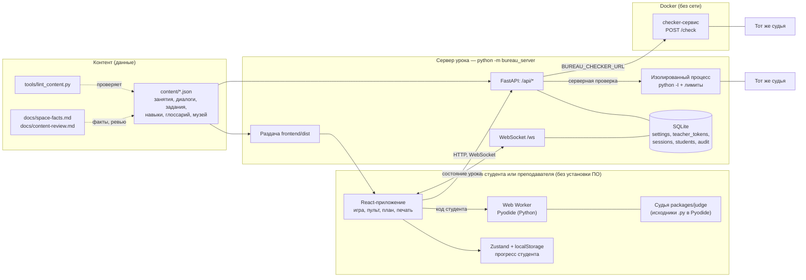
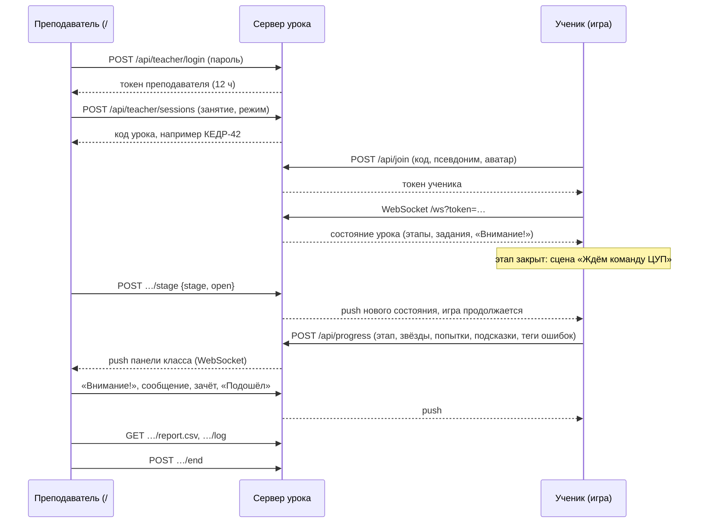

# Архитектура курса «Поехали!»

Для методиста, эксперта и разработчика, который будет сопровождать ресурс. Что из чего состоит, как данные идут во время урока, где проверяется код и что хранится о студенте.

Стек: React 18 + TypeScript + Vite, Zustand, CodeMirror 6, Framer Motion — на клиенте; Pyodide в Web Worker — исполнение Python в браузере; Python 3.11+ (FastAPI + WebSocket + SQLite из stdlib) — сервер урока; контент — JSON-файлы. Всё локально, без CDN, внешних сервисов и зарубежных SaaS.

## 1. Схема компонентов

Один процесс сервера раздаёт и игру (`frontend/dist`), и API. Один и тот же код судьи работает в трёх местах: в Pyodide (быстрая проверка у студента), в изолированном процессе сервера и в контейнере checker.

### Компоненты по каталогам

| Компонент | Каталог | Роль |
|---|---|---|
| Игра | `frontend/src/game` | Сцены, диалоги, зал бюро, рабочее место задания, телефон |
| Диалоговый движок и проверки | `frontend/src/dialogue` | Узлы сценария, 8 типов проверок |
| Слой урока | `frontend/src/lesson` | Вход по коду, связь с сервером, «Внимание!», «Ждём команду ЦУП» |
| Пульт | `frontend/src/teacher` | `/#/teacher`: этапы, задания, панель класса, отчёт |
| Логика допуска и экономика | `frontend/src/lib` (`gate.ts`, `economy.ts`, `bkt.ts`) | Чистые функции с тестами Vitest |
| Исполнение Python | `frontend/src/py` (`worker.ts`, `runner.ts`) | Pyodide 314.0.7 в Web Worker, таймаут, перезапуск воркера |
| Графика | `frontend/src/art` (стиль v2 в `art/v2`) | Собственные слоистые SVG |
| Судья | `packages/judge/judge` | Песочница, кейсы, AST-правила, стиль, оценка, переводчик ошибок, трассировщик, детекторы |
| Сервер урока | `server/bureau_server` (`app.py`, `store.py`, `codes.py`, `checker.py`) | Сессии, коды, допуск, журнал, отчёт, серверная проверка |
| Контент | `content/` | Занятия, диалоги, задания, персонажи, навыки, глоссарий, музей |
| Линтер контента | `tools/lint_content.py` | Автоматическая методическая проверка |

Маршруты клиента (hash-роутер, `frontend/src/App.tsx`): `/` — игра, `/#/teacher`, `/#/plan/:n`, `/#/art`, `/#/checks`, `/#/style`; страницы `/#/present`, `/#/experts`, `/#/print/:n` добавляются в текущей версии.

## 2. Контент как данные

- Всё содержание — JSON в `content/`; код приложения не содержит текстов занятий. Схема — `docs/content-schema.md`.
- Узлы сценария: `scene`, `say`, `choice`, `check`, `board`, `input`, `launch` и др.; задание описывает ТЗ, вопросы брифинга, видимые и скрытые кейсы, эталон, шаблоны, подсказки, AST-правила.
- Линтер (`python tools/lint_content.py`) проверяет: длину реплик и абзацев, не более одного нового термина, ритм «не более 4 реплик без проверки», порядок навыков (`requires`/`introduces`), отсутствие циклов в графе навыков, `allowed_constructs` занятия для эталонов (по AST), автотест каждого задания (эталон получает 5★, шаблон проваливает хотя бы один кейс, у скрытых кейсов есть `complaint` и `requirement_id`), привязку экспонатов музея к фактам и наличие названия аппарата у узла `launch`.
- Достоверность: факты — только из `docs/space-facts.md`, сюжетные тексты помечены `review_needed: true` и перечислены в `docs/content-review.md`, `docs/review/*.md`.

## 3. Поток данных урока

1. **Вход по коду.** Код урока вводится человеком, поэтому нормализуется (`server/bureau_server/codes.py`): регистр, пробелы и дефисы, латиница вместо кириллицы, транслит, английская раскладка, ё/е.
2. **Допуск этапов.** В режиме «Вместе с классом» все этапы закрыты; открытие этапа открывает и предыдущие, закрытие — и последующие. Логика допуска — чистые функции `frontend/src/lib/gate.ts` (`stageAllowed`, `orderAllowed`, `effectiveStars`), каждая новая механика обязана их использовать. Сервер хранит состояние и рассылает его; клиент применяет.
3. **Прогресс.** Полный прогресс студента хранится в его браузере (`localStorage`); на сервер уходит сводка: этап, звёзды, число проверок и подсказок по заданиям, доля верных ответов, теги ошибок.
4. **Панель класса.** Статусы вычисляются из сводки и событий («Застрял» — ≥ 3 проверок задания без принятия или 5 минут без действий). «Частые ошибки класса» — агрегация тегов переводчика ошибок.
5. **Связь.** WebSocket с переподключением + опрос `/api/state` раз в 20 с + ping каждые 25 с. При потере урока на сервере (401/404) ученик продолжает самостоятельно.
6. **Отчёт и журнал.** Журнал (`audit`) пишет входы, открытия этапов, «Внимание!», зачёты и вызовы с временем; отчёт CSV — одна строка на ученика (этапы, верно/всего, вызовы, звёзды/проверки/подсказки по каждому заданию, принято/зачтено).
7. **Завершение.** Вход по коду закрывается; ученики продолжают самостоятельно с сохранённым прогрессом.

Без сервера (режим «Самостоятельно») слой урока выключен, этапы открываются по порядку прохождения.

## 4. Проверка кода

### 4.1 Судья (единый источник проверки)

Вся оценка кода студента — только в `packages/judge` (чистый Python 3.11+, без зависимостей). TypeScript отображает результат и считает экономику для показа.

- **Детерминизм:** бесконечные циклы останавливает лимит строк (`sys.settrace`), а не время; нет `time`, глобального `random`, сети.
- **Результат:** `run_order(source, order, …)` → stdout, ошибка, отчёт AST, отчёт стиля, кейсы, события для анимации стенда, итог. Сериализация — `judge.to_json`.
- **Скрытые кейсы** не раскрывают ввод и ожидаемый вывод, только замечание заказчика (`complaint`).
- **Оценка:** видимые тесты 40, скрытые 30, стиль 10, самостоятельность 10, точность уточнения 10 → ★1–5.

### 4.2 Локально в браузере

Код студента выполняется только в Web Worker с Pyodide: страница не зависает, воркер перезапускается при таймауте, доступ к DOM и сети из пользовательского кода отсутствует. Судья загружается в Pyodide исходниками `.py`. Это даёт мгновенную обратную связь и работу без сервера.

### 4.3 Серверная проверка в изолированном процессе (Docker-checker)

`server/bureau_server/checker.py`, эндпоинт `POST /api/check`. Нужна, чтобы скрытые кейсы и награды не зависели от браузера студента. Включается только вместе с сервисом проверки; без него браузер проверяет сам, как раньше.

- Задание со скрытыми кейсами берётся из контента **сервера**, а не из запроса браузера.
- Код студента **не выполняется в процессе API**. Запускается отдельный `python -I` с пустым окружением, временным рабочим каталогом, таймаутом (20 с) и, на Linux, лимитами CPU (15 с), памяти (512 МБ), размера файла и числа процессов; размер исходника ограничен (20 000 символов).
- Развёртывание с Docker (`docker-compose.yml`): сервис `checker` (`python -m bureau_server.checker --serve`, `POST /check`) во внутренней сети без выхода наружу, файловая система только для чтения, без привилегий, лимит процессов и памяти; сервер урока обращается к нему по `BUREAU_CHECKER_URL`.
- Без `BUREAU_CHECKER_URL` серверная проверка **выключена** (`/api/check` отвечает 503, браузер проверяет сам): сам сервер урока код студента не исполняет. Флаг `BUREAU_LOCAL_CHECK=1` запускает изолированный процесс рядом с сервером — только для разработки и тестов.
- В синхронном уроке проверка возможна только после того, как преподаватель открыл этап с заданиями, и только для открытых заданий текущего занятия; одна проверка за раз на ученика.
- Лучшие звёзды серверной проверки сохраняются в `grants.checked` и учитываются в `effectiveStars`, панели класса, проекторе и отчёте CSV; на пульте виден последний код ученика и результат проверки.
- Те же исходники судьи, поэтому результат совпадает с браузерным.

Ограничение: скрытые кейсы по-прежнему есть и в клиентском бандле (браузер должен уметь проверять без сервера). Сервер берёт кейсы из своего контента, поэтому при включённом checker результат нельзя подделать правкой бандла, но прочитать кейсы в бандле можно.

### 4.4 Помощник Вика

«Интеллектуальная обучающая система на правилах», не ИИ и не LLM: переводчик ошибок (`explain.py`), детекторы типичных багов (`detectors.py`), лестница подсказок без готового решения, глоссарий с нечётким поиском (Fuse.js + русский стеммер, `frontend/src/lib/stem.ts`), BKT (`frontend/src/lib/bkt.ts`: p_init 0,15, p_learn 0,20, p_slip 0,10, p_guess 0,20, порог 0,85).

## 5. Безопасность и приватность

| Область | Что сделано | Где |
|---|---|---|
| Персональные данные | ФИО не собираются и не хранятся; у студента только псевдоним и выбор аватара (152-ФЗ) | `POST /api/join`; `PROMPT.md` §11 |
| Пароль преподавателя | Хеш scrypt (stdlib), пароль печатается при первом запуске; смена `--set-password`, новый случайный `--reset-password` | `server/bureau_server/store.py`, `__main__.py` |
| Токены | Токен преподавателя живёт 12 часов (`TEACHER_TOKEN_TTL`); токен ученика выдаётся при входе; токены не взаимозаменяемы | `store.py` |
| Перебор | Ограничение попыток входа преподавателя: 10 неудач за 5 минут с одного адреса → 429; ограничение попыток ввода кода урока | `app.py` (`LOGIN_MAX_FAILS`, `LOGIN_WINDOW`) |
| Права | Права проверяются на каждом эндпоинте и в WebSocket; ученик не имеет доступа к API преподавателя (покрыто тестом) | `app.py`, `server/tests/test_server.py` |
| Код студента | Исполняется только в Web Worker (браузер) или в изолированном процессе/контейнере checker; сервер урока код не исполняет | раздел 4 |
| Скрытые кейсы | Не раскрываются ни в результате судьи, ни в интерфейсе | `judge.public_order`, тесты судьи |
| Данные урока | Локальная SQLite на компьютере преподавателя; никаких внешних сервисов, аналитики и CDN | `server/bureau_server/store.py` |
| Контент | Графика собственная, без чужих материалов и логотипов реальных организаций; реальные люди не произносят реплик | `assets/LICENSES.md`, `docs/world.md` |
| Валидация | Модели Pydantic с ограничением длин и значений; прогресс проверяется перед сохранением | `app.py` |

## 6. Тесты и качество

| Что | Команда | Что проверяет |
|---|---|---|
| Судья, линтер, контент, сервер | `python -m pytest -q packages/judge/tests tools/tests server/tests` | детерминизм, нормализация, кейсы, AST, стиль, лимиты, отсутствие утечки скрытых кейсов; правила линтера и реальный контент; сервер урока: «грязные» коды, вход и лимит попыток, блокировка этапов, WebSocket-рассылка, права, валидация прогресса, журнал, отчёт, checker |
| Линтер контента | `python tools/lint_content.py` | методические правила и автотест каждого задания (0 ошибок) |
| Фронтенд | `cd frontend && npm test` | Vitest: движок сценария, логика проверок, экономика, BKT, допуск (`gate.ts`), статусы панели, список занятий |
| Типы и сборка | `cd frontend && npm run build` | `tsc` strict + Vite |
| Идентичность | `cd frontend && npm run test:identity` | судья в CPython и в Pyodide выдаёт побайтово одинаковый JSON |
| Браузер | вручную перед «готово» | светлая/тёмная тема, 360 px и десктоп, нет горизонтального скролла и пересечений (`getBoundingClientRect`), сценарий «преподаватель открывает этап → ученик продолжает» |
| e2e и Lighthouse | запланированы (Playwright; Performance ≥ 90, Accessibility ≥ 95) | сквозные сценарии и качество страницы |

Число проверок на момент последней записи состояния — `CONTEXT.md`.

## 7. Расширение

- Темы МДК 5.4.2–5.4.6: режимы судьи `func`, `class`, `data` (интерфейсы в `packages/judge/judge/modes.py`) и новые занятия `content/lessons/lessonN.json` без переписывания ядра.
- Новый контент добавляется как данные и проходит линтер; новые механики используют `gate.ts`.
- Развёртывание в сети колледжа: тот же сервер, адрес для учеников печатается при запуске; checker — в контейнере без сети.

## Связанные документы

- `PROMPT.md` — ТЗ (разделы 5, 6, 9, 11, 13–15)
- `docs/decisions.md` — принятые решения (в т. ч. №32–41)
- `docs/content-schema.md` — формат контента
- `docs/teacher-guide.md` — запуск и проведение урока
- `docs/criteria-mapping.md` — соответствие критериям конкурса
- `docs/approbation-guide.md` — апробация
- `docs/ux-research.md` — юзабилити-тестирование
- `CONTEXT.md`, `README.md`, `CLAUDE.md`
